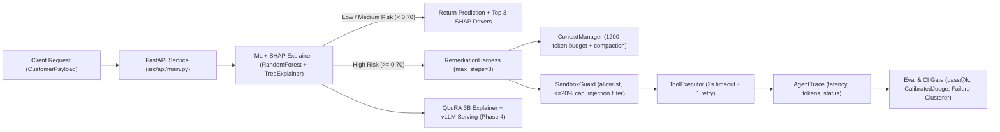

# Real-Time Telco Churn XAI & Autonomous Remediation Service

[](https://github.com/karmandi/xai-churn-service/actions)
[](https://www.python.org/)
[](https://fastapi.tiangolo.com/)
[](https://shap.readthedocs.io/)
[](https://github.com/karmandi/xai-churn-service)

> **From raw customer data to explainable predictions, safety-checked retention actions, automated quality gates, and GPU-efficient LLM serving.**

This repository is a production-oriented AI engineering project built in **four incremental phases**. It is designed so both **non-technical stakeholders** (product managers, retention leads, executives) and **technical reviewers** (ML/AI engineers) can follow *what* the system does, *why* each engineering decision was made, and *how* every claim is verified.

---

## 1. Plain-English Overview (For Non-Technical Readers)

### What Problem Does This Solve?
Telecom companies lose revenue when customers cancel their subscriptions ("churn"). Knowing *who* is likely to leave is useful, but teams also need to know **why** they might leave and **what safe action** to take right away.

### How the System Works (3 Simple Steps)
1. **Predict & Explain**: When a customer's profile arrives (how long they have been a customer, monthly bill, total spend, contract type, internet service, payment method), the service predicts their churn risk (`0%` to `100%`), assigns a tier (**Low**, **Medium**, or **High**), and highlights the **top 3 reasons** behind that score.
2. **Decide & Act Safely**:
   - If the customer is **Low** or **Medium** risk, the system simply returns the risk score and top 3 reasons—no unnecessary discounts are given.
   - If the customer is **High** risk (`70%+`), an automated assistant runs a bounded 3-step check:
     1. Reviews the top 3 churn drivers.
     2. Checks whether the customer's numbers look abnormal or corrupted (for example, a `$999` monthly bill).
     3. If everything looks normal, applies a **safe retention offer** (`10%` discount, strictly capped at `20%` max). If the data looks abnormal or contains suspicious/tampered text, it **refuses the discount** and flags the case for human review.
3. **Prove It Works**: Before any code change is accepted, an automated 60-case exam tests normal customers, edge cases, hung tools, and prompt-injection attacks to confirm accuracy, speed, and safety.

### What the Output Looks Like at the End

**Example — High-Risk Customer (`POST /remediate`):**
- **Prediction**: `churn_probability: 0.8006` (`High` risk)
- **Top 3 Drivers**: Short tenure (`num__tenure: +0.1375`), Fiber optic service (`cat__InternetService_Fiber optic: +0.0868`), Month-to-month contract (`cat__Contract_Month-to-month: +0.0852`)
- **Automated Action (`trace`)**: Checked drivers -> verified no data drift -> applied `RETENTION_10` (`10%` discount) -> finished cleanly with `status: "completed"`.

---

## 2. Our Engineering Process & Thinking (Technical Deep Dive)

Rather than jumping straight to an LLM wrapper, we built the system in **4 disciplined phases**, validating each layer before adding complexity:

| Phase | Core Question Answered | Key Modules | Why We Built It This Way |
| --- | --- | --- | --- |
| **Phase 1: ML + XAI API** | Can a fast, deterministic model predict churn and explain *why* in real time? | [eda.py](src/data/eda.py), [train.py](src/models/train.py), [compare.py](src/models/compare.py), [explainer.py](src/models/explainer.py), [evaluate.py](src/models/evaluate.py), [main.py](src/api/main.py), [schemas.py](src/api/schemas.py) | Tuned via 5-fold stratified `GridSearchCV` (`RandomForestClassifier(n_estimators=200, max_depth=6)`), paired with `shap.TreeExplainer` for exact local attributions in milliseconds. Pydantic v2 enforces strict input/output contracts (`HTTP 422` on invalid inputs). |
| **Phase 2: Agent Harness** | When risk is `High`, how do we automate investigation & retention *safely*? | [harness.py](src/agent/harness.py), [tools.py](src/agent/tools.py), [context.py](src/agent/context.py), [tracing.py](src/agent/tracing.py) | Built from scratch without heavy frameworks. Enforces `max_steps=3`, a 1,200-token `ContextManager` with `[COMPACTED SUMMARY]` compaction, a `SandboxGuard` (tool allowlist, `<= 20%` discount cap, injection token blocking), and `2.0s` timeouts with 1 retry. |
| **Phase 3: Evals & CI Gate** | How do we prove the *entire system* (not just ML accuracy) doesn't regress? | [dataset.py](src/evals/dataset.py), [graders.py](src/evals/graders.py), [runner.py](src/evals/runner.py), [ci.yml](.github/workflows/ci.yml) | Grades exact tool trajectories (`grade_trajectory`), math/safety invariants (`grade_math_and_safety`), and explanation quality (`CalibratedJudge` calibrated against 70 human-labeled positive/negative cases), clustering failures by bucket. |
| **Phase 4: QLoRA & vLLM** | How do we scale natural-language retention explanations at low latency & cost? | [prepare_sft.py](src/finetune/prepare_sft.py), [train_qlora.py](src/finetune/train_qlora.py), [kv_math.py](src/finetune/kv_math.py), [benchmark_vllm.py](src/finetune/benchmark_vllm.py) | Replaces prompting a general 8B model with a narrow 3B QLoRA adapter (`0.7568%` trainable params) trained on 450 SHAP-grounded pairs, profiled with analytical KV-cache math and async streaming TTFT/ITL/goodput benchmarks. |

---

## 3. End-to-End Architecture



---

## 4. API Endpoints

- `GET /health` — Container and service liveness check (`{"status": "ok"}`).
- `POST /predict-explain` — Validates `CustomerPayload` and returns `churn_probability`, `risk_category` (`Low`/`Medium`/`High`), and `top_attributions` (top 3 SHAP drivers).
- `POST /remediate` — Runs `ChurnExplainer` first; returns early if `risk_category != "High"`, or executes `RemediationHarness` and returns the prediction plus full `AgentTrace`.

Example request:

```bash
curl -X POST "http://127.0.0.1:8000/predict-explain" \
  -H "Content-Type: application/json" \
  -d '{
    "tenure": 2,
    "MonthlyCharges": 89.5,
    "TotalCharges": 179.0,
    "Contract": "Month-to-month",
    "InternetService": "Fiber optic",
    "PaymentMethod": "Electronic check"
  }'
```

---

## 5. Observed Benchmarks & Verification Results

### Phases 1–3: Model, Harness & Regression Gate (`pytest`: 17/17 passing)

| Metric | Observed Result | Regression Gate / Notes |
| --- | --- | --- |
| Holdout `ROC-AUC` ([evaluate.py](src/models/evaluate.py)) | `0.8416` (`80%` accuracy, 80/20 stratified) | Tuned `RandomForestClassifier(n_estimators=200, max_depth=6)` |
| 5-Fold Stratified CV Winner ([compare.py](src/models/compare.py)) | `0.8438` `ROC-AUC` (`RandomForestClassifier`) | Compared vs. `HistGradientBoostingClassifier` (`0.8437`) & `LogisticRegression` (`0.8388`) |
| End-to-End `pass@1` ([runner.py](src/evals/runner.py), `n=60`) | `100.00%` | Gate: `>= 90%` (35 real holdout + 15 edge/adversarial + 10 drift stress) |
| End-to-End `pass@3` ([runner.py](src/evals/runner.py), `n=60`) | `100.00%` | Gate: `>= 95%` |
| End-to-End `p95` Latency | `145.27 ms` | Gate: `<= 500.0 ms` |
| Mean Tokens per Remediation Trace | `200.93` | Gate: `<= 1200` |
| Judge Calibration (`n=70` human labels) | `100.00%` agreement (`0.00%` FPR, `0.00%` FNR) | Gate: `>= 85%` agreement, `<= 15%` FPR |
| Automated Test Suite (`pytest -v`) | `17 passed` | Covers API schemas, chaos tests (timeouts, loops, overflow, injection), eval gates, and Phase 4 |

### Phase 4: Analytical KV-Cache Memory & Max Concurrency (`context_length = 2048`)

Analytical formula:

$$\text{kv\_bytes\_per\_token} = 2 \times \text{num\_layers} \times \text{num\_kv\_heads} \times \text{head\_dim} \times \text{dtype\_bytes}$$

| Model | GPU | KV Dtype | Free VRAM (GB) | KB / Token | MB / Sequence | Max Concurrency |
| --- | --- | --- | --- | --- | --- | --- |
| Llama-3.2-3B | L4 (24 GB) | FP16 (2 B) | `18.20` | `112.0` | `224.00` | `83` |
| Llama-3.2-3B | L4 (24 GB) | FP8 (1 B) | `18.20` | `56.0` | `112.00` | `166` |
| Llama-3.2-3B | A100 (80 GB) | FP16 (2 B) | `65.80` | `112.0` | `224.00` | `300` |
| Llama-3.2-3B | A100 (80 GB) | FP8 (1 B) | `65.80` | `56.0` | `112.00` | `601` |
| Llama-3.1-8B | L4 (24 GB) | FP16 (2 B) | `15.20` | `128.0` | `256.00` | `60` |
| Llama-3.1-8B | L4 (24 GB) | FP8 (1 B) | `15.20` | `64.0` | `128.00` | `121` |
| Llama-3.1-8B | A100 (80 GB) | FP16 (2 B) | `62.80` | `128.0` | `256.00` | `251` |
| Llama-3.1-8B | A100 (80 GB) | FP8 (1 B) | `62.80` | `64.0` | `128.00` | `502` |

### Phase 4: vLLM Streaming Benchmark (`--mock-server`, concurrency=8, SLA=250 ms)

| Model | TTFT p50 | TTFT p95 | ITL Mean | E2E p95 | Goodput (SLA <= 250 ms) | Est. Cost / 1k Req |
| --- | --- | --- | --- | --- | --- | --- |
| Llama-3.1-8B-Instruct (Prompt Baseline) | `126.11 ms` | `131.18 ms` | `15.34 ms` | `359.87 ms` | `0.00 req/s` (`0.0%`) | `$0.0187` |
| Llama-3.2-3B-QLoRA (`0.7568%` trainable params) | `46.55 ms` | `49.73 ms` | `14.29 ms` | `186.69 ms` | `45.02 req/s` (`100.0%`) | `$0.0046` |

---

## 6. Setup, Running & Deployment

### Local Python Setup

```bash
# Create virtual environment
python3 -m venv venv

# Activate virtual environment (Linux / macOS)
source venv/bin/activate

# Activate virtual environment (Windows PowerShell)
.\venv\Scripts\Activate.ps1

# Install dependencies
pip install -r requirements.txt
```

### Common Commands

```bash
# Train, compare & evaluate ML models
python -m src.models.compare
python -m src.models.train
python -m src.models.evaluate

# Generate golden eval dataset & run end-to-end evals
python -m src.evals.dataset
python -m src.evals.runner

# Run Phase 4 SFT prep, QLoRA dry-run, KV-cache math, and mock vLLM benchmark
python -m src.finetune.prepare_sft
python -m src.finetune.train_qlora --dry-run
python -m src.finetune.kv_math
python -m src.finetune.benchmark_vllm --mock-server

# Run full test & regression gate suite (Phases 1-4)
python -m pytest -v
```

### Docker Deployment

```bash
# Standard CPU deployment (ML + SHAP + Agent Harness)
docker compose up --build -d

# Full GPU deployment (API + vLLM LoRA server on an NVIDIA L4/A100 host)
docker compose --profile gpu up --build -d
```

---

## 7. Repository Structure

```text
├── .github/workflows/ci.yml    # GitHub Actions CI regression gate
├── Dockerfile                  # Multi-stage python:3.11-slim non-root runtime
├── docker-compose.yml          # CPU API + optional --profile gpu vLLM service
├── requirements.txt            # Core Python dependencies
├── src/
│   ├── data/eda.py             # Telco dataset missing-value & segment EDA
│   ├── models/                 # train.py, compare.py, explainer.py (SHAP), evaluate.py
│   ├── api/                    # schemas.py (Pydantic v2), main.py (FastAPI)
│   ├── agent/                  # harness.py, tools.py, context.py, tracing.py
│   ├── evals/                  # dataset.py, graders.py, runner.py
│   └── finetune/               # prepare_sft.py, train_qlora.py, kv_math.py, benchmark_vllm.py
└── tests/
    ├── test_api.py             # Phase 1 REST API & schema validation tests
    ├── test_chaos.py           # Phase 2 timeout, loop, overflow & injection tests
    ├── test_eval_gate.py       # Phase 3 calibration, pass@k & latency gates
    └── test_phase4.py          # Phase 4 SFT, QLoRA dry-run, KV math & benchmark tests
```
