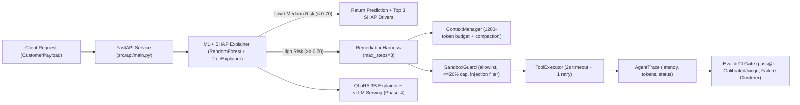

# Real-Time Telco Churn XAI & Autonomous Remediation Service

This repository implements a production-grade AI engineering system for real-time telecommunications customer churn prediction, SHAP local feature attribution, bounded autonomous remediation, end-to-end evaluation gates, and narrow QLoRA + vLLM serving optimization.

## Setup

Create and activate a Python virtual environment, then install the dependencies:

```bash
# Create virtual environment
python3 -m venv venv

# Activate virtual environment (Linux / macOS)
source venv/bin/activate

# Activate virtual environment (Windows PowerShell)
.\venv\Scripts\Activate.ps1

# Install dependencies
pip install -r requirements.txt
```

---

## End-to-End Architecture



---

## Portfolio Benchmark & Evaluation Summary

### Phases 1–3: Model, Harness & Regression Gate Results

| Metric | Observed Result | Gate / Notes |
| --- | --- | --- |
| Baseline Holdout ROC-AUC (`src/models/evaluate.py`) | `0.8628` (full) / `0.8409` (80/20 stratified) | Verified SHAP directional consistency |
| End-to-End `pass@1` (`src/evals/runner.py`, n=60) | `100.00%` | Gate: `>= 90%` |
| End-to-End `pass@3` (`src/evals/runner.py`, n=60) | `100.00%` | Gate: `>= 95%` |
| End-to-End `p95` Latency | `46.58 ms` | Gate: `<= 500.0 ms` |
| Mean Tokens per Remediation Trace | `201.72` | Gate: `<= 1200` |
| Judge Calibration (`n=70` human labels) | `100.00%` agreement (`0.00%` FPR, `0.00%` FNR) | Gate: `>= 85%` agreement, `<= 15%` FPR |

---

### Phase 4: Analytical KV-Cache Memory & Max Concurrency (`context_length = 2048`)

Analytical formula:

$$\text{kv\_bytes\_per\_token} = 2 \times \text{num\_layers} \times \text{num\_kv\_heads} \times \text{head\_dim} \times \text{dtype\_bytes}$$

| Model | GPU | KV Dtype | Free VRAM (GB) | KB / Token | MB / Sequence | Max Concurrency |
| --- | --- | --- | --- | --- | --- | --- |
| Llama-3.2-3B | L4 (24 GB) | FP16 (2 B) | `18.20` | `112.0` | `224.00` | `83` |
| Llama-3.2-3B | L4 (24 GB) | FP8 (1 B) | `18.20` | `56.0` | `112.00` | `166` |
| Llama-3.2-3B | A100 (80 GB) | FP16 (2 B) | `65.80` | `112.0` | `224.00` | `300` |
| Llama-3.2-3B | A100 (80 GB) | FP8 (1 B) | `65.80` | `56.0` | `112.00` | `601` |
| Llama-3.1-8B | L4 (24 GB) | FP16 (2 B) | `15.20` | `128.0` | `256.00` | `60` |
| Llama-3.1-8B | L4 (24 GB) | FP8 (1 B) | `15.20` | `64.0` | `128.00` | `121` |
| Llama-3.1-8B | A100 (80 GB) | FP16 (2 B) | `62.80` | `128.0` | `256.00` | `251` |
| Llama-3.1-8B | A100 (80 GB) | FP8 (1 B) | `62.80` | `64.0` | `128.00` | `502` |

### Phase 4: vLLM Serving Comparison (`--mock-server`, concurrency=8, SLA=250 ms)

| Model | TTFT p50 | TTFT p95 | ITL Mean | E2E p95 | Goodput (SLA <= 250 ms) | Est. Cost / 1k Req |
| --- | --- | --- | --- | --- | --- | --- |
| Llama-3.1-8B-Instruct (Prompt Baseline) | `126.11 ms` | `131.18 ms` | `15.34 ms` | `359.87 ms` | `0.00 req/s` (`0.0%`) | `$0.0187` |
| Llama-3.2-3B-QLoRA (Fine-Tuned, `0.7568%` trainable params) | `46.55 ms` | `49.73 ms` | `14.29 ms` | `186.69 ms` | `45.02 req/s` (`100.0%`) | `$0.0046` |
